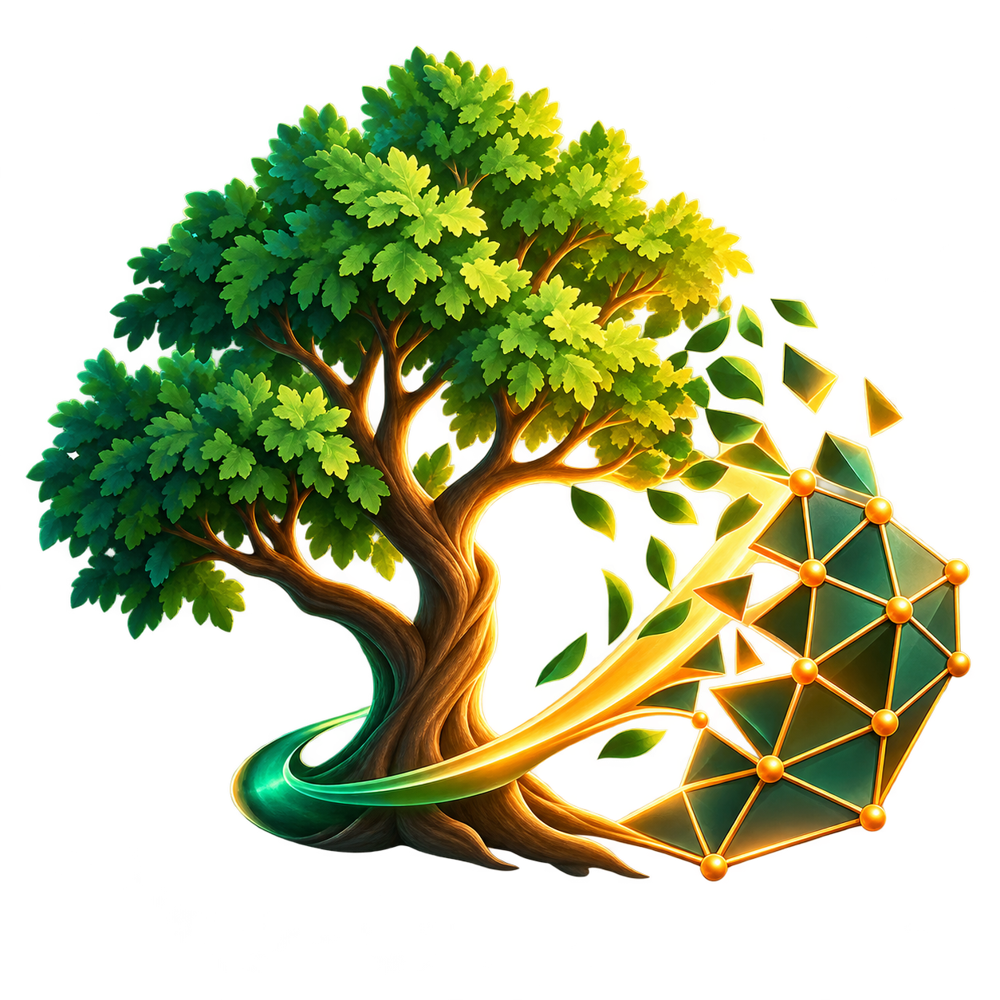
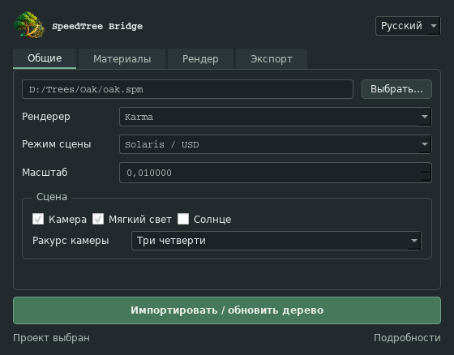

# SpeedTree Bridge for Houdini

[Русский](README.ru.md) · [Download v0.5.2](https://github.com/sdomasov269-maker/SpeedTreeHoudiniBridge/releases/tag/v0.5.2) · [Installation](docs/INSTALLATION.md)



Import SpeedTree trees, build materials and keep your Houdini scene updated from one native plugin window.

**Latest release: 0.5.2.** Supports Arnold, Redshift and Karma, with OBJ and Solaris workflows.



## Features

- Import OBJ / FBX geometry, `.stmat` material definitions and textures.
- Transfer saved SpeedTree `.spm` projects through the installed Modeler. Update manually or automatically after saving.
- Keep the same tree object on live updates, preserving transforms, existing shader edits and downstream SOP nodes.
- Build Arnold Standard Surface, Redshift Standard/legacy materials and Karma MaterialX materials.
- Create isolated Solaris scenes with USD material bindings, a camera, optional lights and a renderer-specific USD Render output.
- Store independent material and Solaris render settings for each renderer. Karma supports CPU and XPU.
- Support opacity, vertex opacity, packed texture channels, normal maps, roughness/gloss, AO and subsurface maps.
- Frame the camera from the transformed tree bounds and the render aspect ratio. Reframe an existing tree or camera from the plugin menu.
- Import multiple `.stmat` exports in one batch.
- Use English, Russian, Japanese, Simplified Chinese or Traditional Chinese in the native interface.

## New in 0.5.2

This release brings the native Live Bridge, Solaris integration for Arnold / Redshift / Karma, automatic render outputs and tabbed **General / Materials / Render / Export** settings to the GitHub distribution.

It also improves the import and camera workflow:

- SpeedTree OBJ trees are automatically rotated **−90° around X** into Houdini's vertical orientation, before camera framing and USD translation.
- Cameras have independent transforms and do not inherit the tree's rotation or scale.
- Camera framing respects landscape and portrait render formats, with matching clipping and focus distances.
- Camera and light guide icons are sized relative to the tree.
- **SpeedTree Bridge → Reframe Tree / Camera** repairs older camera setups and their Solaris camera targets without reimporting the mesh.
- Repeated live updates retain node paths, preserve user edits and roll back failed updates.

See [CHANGELOG.md](CHANGELOG.md) for the full release history.

## Install

1. Download **SpeedTreeBridge-0.5.2.zip** from [Releases](https://github.com/sdomasov269-maker/SpeedTreeHoudiniBridge/releases/tag/v0.5.2).
2. Extract it to a permanent writable folder.
3. Open a terminal in the extracted folder and run:

```powershell
python install_houdini.py --version 21.0
```

Use your Houdini version, or `python install_houdini.py --all` to register all supported preference folders. Restart Houdini, then open **SpeedTree Bridge → Open SpeedTree Bridge**.

A separate Python installation is optional: the [installation guide](docs/INSTALLATION.md) also explains installation using Houdini's Python Source Editor.

## Use

1. In **General**, choose a `.stmat` export or a saved `.spm` project, a renderer and the initial scale. Choose **Solaris / USD** for a Solaris scene; Karma always uses Solaris.
2. In **Materials**, configure roughness and normal maps. In **Render**, configure the Solaris resolution, samples and output image.
3. For `.spm`, use **Export** to choose SpeedTree Modeler, the cache folder and optional save-triggered updates.
4. Click **Import / Update tree**. Render from the generated node in `/out`, or view the generated scene in `/stage`.

Geometry, materials and render outputs remain editable in Houdini. After changing the tree's transform or shape, select its object or camera and use **Reframe Tree / Camera** when a new camera fit is needed.

[Live Bridge guide](docs/LIVE_BRIDGE.md) · [Solaris guide (Russian)](docs/SOLARIS.ru.md)

## Compatibility

Tested locally on **Windows, Houdini 21.0.596 and 22.0.368**, with SpeedTree Modeler **10.2**. Python 3 adapters target Houdini 19–22; older versions still need end-to-end testing.

Arnold and Redshift require integrations compatible with the exact Houdini build, including a Hydra delegate for Solaris. Karma uses Houdini's installed renderer. Bridge does not include renderer binaries, SpeedTree or licenses. Live `.spm` transfer requires a Modeler edition that supports command-line export.

Static geometry is supported. Wind animation, Alembic and automatic displacement are outside this release. Renderer images are not guaranteed to match exactly. See [compatibility and validation details](COMPATIBILITY.md).

## Help develop the project

SpeedTree Bridge is a community project. Access to different Houdini versions, operating systems and renderer integrations is limited, so wider testing and contributions are especially valuable.

If the plugin is useful to you, please help it grow:

- Test it on your setup and share reproducible results through [Issues](https://github.com/sdomasov269-maker/SpeedTreeHoudiniBridge/issues).
- Suggest workflow improvements, contribute fixes or translations, and submit pull requests.
- Share small, redistributable test exports and help improve the documentation.
- Star the repository and share it with other artists who could use or contribute to the project.

Include your Houdini build, renderer version, operating system and reproduction steps in reports. Please remove private paths and do not upload assets you cannot redistribute.

[Contribution guide](CONTRIBUTING.md) · [Roadmap](ROADMAP.md) · [License](LICENSE)
