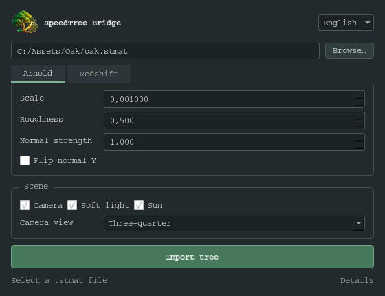

# SpeedTree Bridge для Houdini

[English](README.md) · [Установка](docs/INSTALLATION.ru.md) · [Совместимость](COMPATIBILITY.md)


Бесплатный плагин для импорта экспорта SpeedTree в Houdini, создания материалов Arnold / Redshift и базовой подготовки сцены. Работает внутри Houdini, без отдельного приложения.

**Версия 0.2.0 — предварительная версия для сообщества.** Проверено на Houdini 21.0.596 и 22.0.368. Для 19/20 добавлены адаптеры, но полный запуск ещё не проверен. Сначала экспортируйте mesh, `.stmat` и текстуры из SpeedTree: `.spm` напрямую не поддерживается.



## Возможности

- Импорт OBJ / FBX через `.stmat` с сохранением назначений материалов.
- Arnold Standard Surface, Redshift Standard Material и адаптер старого Redshift Material.
- Color, Opacity, Normal, Gloss / Roughness, Specular, Metallic, AO и subsurface.
- Преобразование gloss в roughness и vertex opacity через `Alpha`.
- Материалы в `/mat`, автоматическая нода Arnold в `/out`.
- Автокамера с тремя ракурсами и привязкой к трансформациям дерева.
- Мягкий и солнечный свет для выбранного движка, по галочкам.
- Компактное окно, независимые профили рендеров и скрываемая диагностика.
- Русский, английский, японский, упрощённый и традиционный китайский.
- Бесплатное использование и доработка под [лицензией MIT](LICENSE).

## Быстрая установка

1. Скачайте **Code → Download ZIP** и распакуйте в постоянную доступную для записи папку.
2. В этой папке выполните:

   ```powershell
   python install_houdini.py --version 21.0
   ```

   Вместо `21.0` можно выбрать `19.0`, `19.5`, `20.0`, `20.5` или `22.0`. Для всех версий: `python install_houdini.py --all`.
3. Перезапустите Houdini. Откройте **SpeedTree Bridge → Open SpeedTree Bridge** или кнопку на полке.
4. Выберите `.stmat`, движок, масштаб и параметры сцены. Нажмите **Импортировать дерево**.

Подробные варианты установки, включая встроенный Python Houdini, ручную установку и удаление: [инструкция для Houdini 19–22](docs/INSTALLATION.ru.md).

## Требования

Python 3.7+ в Houdini и Arnold / Redshift, совместимый с точным build Houdini. Основная проверенная платформа — Windows. Python 2.7 не поддерживается. Плагин не включает Houdini, SpeedTree, движки рендера и их лицензии. Ограничения редакций Houdini на сторонние рендеры сохраняются.

| Houdini | Статус |
|---|---|
| 19.0 / 19.5 | Адаптеры Python 3 / Qt 5; запуск пока не проверен |
| 20.0 / 20.5 | Адаптеры Python 3 / Qt 5; запуск пока не проверен |
| 21.0.596 | Проверены интерфейс, импорт и материалы Arnold / Redshift |
| 22.0.368 | Проверены интерфейс и импорт Redshift; Arnold здесь не проверен |

Подробнее: [COMPATIBILITY.md](COMPATIBILITY.md).

## Работа и ограничения

Повторный импорт создаёт новые ноды с уникальными именами. Существующие камеры, свет и материалы не заменяются. При ручном удалении дерева отдельно созданные материалы и ноды сцены остаются; импорт можно отменить через Undo.

Масштаб задаётся явно: единицы плагин не угадывает. Камера подключается к Arnold output, если включено её создание. Рендер не запускается автоматически; Redshift output пока не создаётся. Мягкий свет создаётся без HDRI; HDRI можно назначить вручную.

- Нет прямого экспорта из SpeedTree, обновления дерева и пакетного импорта.
- Нет Alembic, ветра, анимации, Solaris / USD и displacement.
- Height, Custom и Custom2 сохраняются как данные без подключения к шейдеру.
- Opacity ожидается в отдельной карте RGB; упакованные каналы и alpha-only карты не поддерживаются.
- UDIM: базовая проверка и передача пути, без полной проверки всех сценариев.
- Используются sRGB / Raw; пользовательская OCIO-конфигурация не анализируется автоматически.
- Проверка узлов не гарантирует одинаковое изображение между версиями рендеров.

## Обратная связь и разработка

При создании Issue укажите точные версии Houdini / рендера, шаги воспроизведения и текст из «Подробности». Прикладывайте только сцены и текстуры, которые имеете право распространять.

```powershell
python -m unittest discover -s tests -p "test_*.py" -v
```

Тесты внутри Houdini запускаются через `hython`: [CONTRIBUTING.md](CONTRIBUTING.md). Личные настройки, диагностические экспорты пользователя и локальные результаты тестов в репозиторий не включаются.

Проект независимый и не является официальным продуктом SideFX, SpeedTree, Autodesk или Maxon. Иконка создана imagegen; [промпт](assets/icon_prompt.txt) сохранён.
